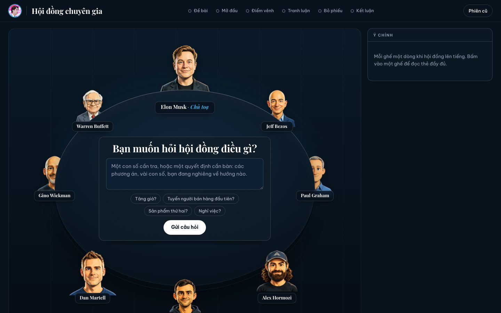

# Hội đồng chuyên gia

Một "hội đồng quản trị" gồm 12 cố vấn AI ngồi quanh một chiếc bàn tròn và tranh luận quyết định kinh doanh của bạn, bằng tiếng Việt. Mỗi cố vấn được dựng từ tác phẩm công khai của một người thật: Jeff Bezos, Paul Graham, Alex Hormozi, Gary Vaynerchuk, Dan Martell, Gino Wickman, Warren Buffett, Naval Ravikant, Codie Sanchez, Leila Hormozi, Sara Blakely. Elon Musk làm Chủ toạ.



Do Yankundart phát triển.

> Các cố vấn là mô phỏng, dựng từ tác phẩm công khai của từng người. Họ không phải người thật và không phát ngôn thay những người đó. Đây là công cụ để suy nghĩ, không phải lời khuyên tài chính, pháp lý hay y khoa.

## Một phiên họp diễn ra thế nào

1. **Bạn hỏi.** Gõ một câu: "Có nên tăng giá dịch vụ không?", "Tuyển người bán hàng đầu tiên hay tự bán tiếp?".
   - Câu chỉ hỏi một con số thì Chủ toạ trả lời luôn (cần nối thư mục tài liệu, xem bên dưới).
2. **Chủ toạ hỏi gốc.** Musk hỏi lại bạn tối đa 5 lượt theo cách tư duy nguyên bản: mục tiêu đo bằng số nào, ai đặt ra yêu cầu, bước nào xoá được, nút thắt thật ở đâu. Câu hỏi đi theo khung của chính ông, kèm mã nguồn như "(thuật toán 5 bước, S014)".
   - Muốn bỏ qua thì bấm "Chạy hội đồng luôn".
3. **Chốt đề bài.** Chủ toạ đề xuất một câu "vấn đề gốc". Bạn sửa hoặc đồng ý; hệ thống soạn 2–4 phương án.
4. **Hội đồng họp.** Chế độ Nhanh có 4 ghế, 2 vòng. Đầy đủ có tới 9 ghế, 3 vòng: quan điểm mở đầu, tranh luận, bỏ phiếu.
   - Mỗi cố vấn chấm điểm từng phương án. Kết luận tính theo điểm có trọng số: LÀM, LÀM CÓ ĐIỀU KIỆN, ĐIỀU CHỈNH, CHỜ hoặc KHÔNG LÀM.
5. **Góc nhìn Chủ toạ.** Sau kết luận, Musk nói ông có đồng ý không. Ông nêu lý do có khung và nguồn, một bước nên xoá, và một thí nghiệm nhanh nhất. Ông không đổi kết luận của hội đồng.
6. **Họp tiếp.** Dưới kết luận có ô "Bổ sung để làm rõ". Thêm thông tin mới rồi bấm "Họp tiếp": hội đồng họp lại cùng chế độ và ghi tiếp vào phiếu cũ.
7. **Phiếu và PDF.** Mỗi quyết định thành một phiếu markdown trong `phieu/`, kèm sổ `phieu/00-so-phieu.md` để hẹn xem lại sau 30 ngày. Nút "Tải PDF" xuất báo cáo kết luận.

## Cần gì

- **Node.js 20 trở lên.** Không cần cài thư viện npm nào.
- **[Claude Code](https://claude.com/claude-code)** và một gói Claude (Pro hoặc Max). Mọi lượt gọi AI chạy qua `claude -p` bằng token của gói.

## Cài đặt

```bash
git clone https://github.com/yankundart6981-wq/hoi-dong-chuyen-gia.git
cd hoi-dong-chuyen-gia
cp .env.example .env
claude setup-token
```

Dán token mà `claude setup-token` in ra vào dòng `CLAUDE_CODE_OAUTH_TOKEN=` trong `.env`. File mẫu đã đặt sẵn `COUNCIL_RUNNER=api`.

## Chạy

```bash
npm start
```

Mở http://localhost:4730.

Thời gian đo được trên máy thật:
- mỗi lượt hỏi khoảng 10–15 giây;
- hội đồng Nhanh khoảng 6–8 phút;
- "Góc nhìn Chủ toạ" thêm khoảng 2–3 phút.

## Nối thư mục tài liệu của bạn (tuỳ chọn)

Đặt `TAI_LIEU_DIR` trong `.env` trỏ tới một thư mục ghi chú của bạn: markdown, văn bản, báo cáo số liệu. Khi đó:

- Chủ toạ đọc thư mục này. Chỉ đọc (Read/Grep/Glob), không sửa, không chạy lệnh.
- Mỗi số liệu được ghi kèm nguồn là đường dẫn file. Chủ toạ dùng tờ sự thật đó để kiểm câu trả lời của bạn trong vòng hỏi, và đưa vào đề bài cho hội đồng.
- Thư mục có `README.md` hoặc `index.md` làm mục lục thì đọc nhanh và đúng hơn.

Không đặt thì hội đồng vẫn chạy bình thường, chỉ là không có số liệu kiểm chứng. Khi đó bạn nên đưa con số thẳng vào câu hỏi.

## Cấu hình (`.env`)

| Biến | Ý nghĩa |
|---|---|
| `CLAUDE_CODE_OAUTH_TOKEN` | Token từ `claude setup-token`. Bắt buộc để phòng tự chạy hội đồng. |
| `COUNCIL_RUNNER` | `api`: chạy hội đồng ngay trong trang. `viewer`: chỉ phát lại hội đồng chạy bằng `/roast-room` trong Claude Code. |
| `TAI_LIEU_DIR` | Thư mục tài liệu để Chủ toạ đọc (tuỳ chọn). |
| `PHIEU_DIR` | Nơi ghi phiếu (mặc định `phieu/` trong repo). |
| `SEAT_MODEL`, `CHAIR_MODEL` | Model cho cố vấn và Chủ toạ (mặc định Sonnet 5.5 và Opus 5.5). |
| `COUNCIL_EFFORT`, `HOI_EFFORT`, `DOC_EFFORT` | Mức suy nghĩ: low, medium, high, xhigh, max. |
| `HOI_BRAIN=nho` | Chủ toạ chỉ nạp phần tóm tắt và nguyên tắc khi hỏi gốc. Dùng khi lượt hỏi quá chậm. |
| `CHAIR_SEAT` | Đổi Chủ toạ sang ghế khác (mặc định `musk`). |
| `CHAIR_VIEW_TIMEOUT_MS` | Thời gian tối đa cho "Góc nhìn Chủ toạ" (mặc định 300000). |

**Đổi logo:** thay hai file `app/public/brand/logo.png` (vuông, khoảng 512×512) và `app/public/brand/favicon.png` (khoảng 128×128) bằng logo của bạn, giữ nguyên tên file. Logo hiện ở góc trang, giữa bàn và đầu file PDF.

Các phần sau nằm ngoài git và ở lại trên máy bạn: phiếu, phiên họp (`sessions/`), `.env`, nguồn thô (`build/`).

## Các cố vấn

Mỗi cố vấn có một "bộ não" trong `.claude/skills/roast-room/brains/<tên>/`, gồm các file:
- `_hot.md`: bản tóm tắt nạp ở mọi lượt;
- `frameworks.md`, `principles.md`, `positions.md`: khung, nguyên tắc, quan điểm;
- `voice.md`, `stories.md`, `books.md`: giọng nói, câu chuyện, sách;
- `sources.md`: danh sách nguồn có mã `S0xx`.

Mọi câu trích là nguyên văn, dưới 45 từ, có mã nguồn; phần còn lại là diễn giải. Ví dụ, não của Elon Musk dựng từ 97 nguồn công khai (khoảng 1,07 triệu từ, 2006–2026).

Trong Claude Code bạn còn dùng được:

- `/roast-room <quyết định>`: chạy hội đồng; trang web phát lại trực tiếp.
- `/roast-room ask <ghế> <câu hỏi>`: hỏi riêng một cố vấn.
- `/roast-room board`: đổi ai ngồi bàn mặc định.
- `/newroaster <tên>`: dựng thêm một cố vấn từ tác phẩm công khai của người đó.

## Kiểm thử

```bash
node --test app/test/*.test.mjs
```

Test dùng một Claude giả (`app/test/fake-claude.mjs`), không gọi AI thật và không ghi vào `sessions/` hay `phieu/` thật.

## Giấy phép và nguồn

- **Mã nguồn:** giấy phép MIT, © 2026 Yankundart. Xem `LICENSE`. Thông báo bản quyền của mã bên thứ ba có trong dự án nằm ở `THIRD_PARTY_NOTICES.md`.
- **Câu trích trong các bộ não:** thuộc về tác giả của chúng. Chúng chỉ là trích đoạn ngắn để bình luận và học tập.
